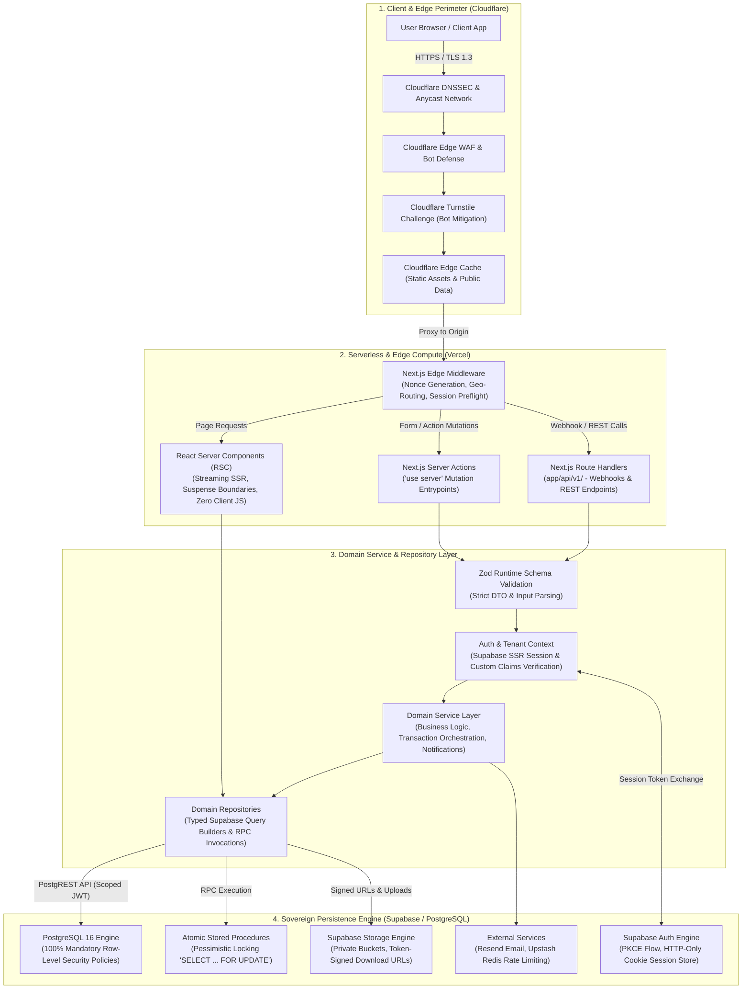

# System Architecture & Design Standard
## Next.js (App Router) + Supabase + Vercel + Cloudflare Enterprise Engine

---

## 1. Executive Summary & Mission

This document defines the definitive architectural standard for enterprise web applications built on the modern full-stack ecosystem: **Next.js (App Router)**, **Supabase (PostgreSQL with RLS)**, **Vercel (Serverless & Edge Compute)**, and **Cloudflare (Zero-Trust Edge Perimeter)**.

The architecture is designed to fulfill three primary operational directives:
1. **Legacy Migration Foundation**: Provide a robust target architecture for converting monolithic and legacy applications (Laravel, Django, Express/Node, Ruby on Rails, CRA/Vite) into a highly scalable, decoupled modern stack.
2. **Enterprise Codebase Hardening**: Upgrade existing Next.js and Supabase applications to strict Software Design & Architecture (SDA) principles, strict multi-tenant boundary isolation, defense-in-depth security, and sub-second streaming performance.
3. **Greenfield SaaS Acceleration**: Serve as the turn-key foundation for new software initiatives with pre-configured Row-Level Security (RLS), automated audit tooling, zero-Cumulative Layout Shift (CLS) user experiences, and automated CI/CD quality gates.

---

## 2. System Topography & Traffic Lifecycle

Traffic flows through four concentric security boundaries before reaching private persistence layers: Edge Perimeter, Compute Runtime, Application Service Layer, and PostgreSQL Database Engine.

### 2.1 Architectural Flow Diagram



### 2.2 Boundary Specifications

| Boundary Layer | Technology | Primary Responsibilities | Security Controls |
| :--- | :--- | :--- | :--- |
| **1. Edge Perimeter** | Cloudflare Enterprise / Pro | Anycast DNS, DDoS mitigation, WAF rule filtering, TLS 1.3 termination, Turnstile bot challenges. | Full Strict SSL, HSTS Preload, DNSSEC, Bot Fight Mode, Edge Rate Limiting. |
| **2. Edge Middleware** | Vercel Edge Runtime | Request preflight, CSP nonce injection, session cookie refresh, tenant host routing. | Cryptographic nonce creation, HTTP-only cookie forwarding, path traversal blocking. |
| **3. Compute Layer** | Next.js 14+ App Router | React Server Component streaming SSR, type-safe Server Actions, zero client JS overhead. | CSRF origin validation, strict separation of `"use client"` and `"use server"`. |
| **4. Service Boundary** | TypeScript / Zod | Business rule enforcement, input parsing, role permission verification, transactional coordination. | Deep schema validation, zero-tolerance IDOR/BOLA checking, audit logging. |
| **5. Database Boundary**| Supabase PostgreSQL 16 | Relational data persistence, row isolation, pessimistic concurrency control, atomic transactions. | Default-deny RLS, foreign key constraints, `SECURITY DEFINER` search path pinning. |

---

## 3. Directory Layout & Module Organization

The project adheres to a Domain-Driven Packaging architecture. Features are organized into isolated, cohesive domain modules rather than technical file buckets.

```
next-supabase-enterprise-engine/
├── app/                                    # Next.js App Router (Routing and Layouts Only)
│   ├── (auth)/                             # Unauthenticated Identity & Onboarding Flow
│   │   ├── login/
│   │   │   ├── page.tsx                    # Login Page (RSC)
│   │   │   └── loading.tsx                 # Zero-CLS Skeleton Loader
│   │   ├── register/
│   │   │   ├── page.tsx
│   │   │   └── loading.tsx
│   │   ├── forgot-password/
│   │   │   └── page.tsx
│   │   ├── callback/
│   │   │   └── route.ts                    # PKCE Auth Callback Route Handler
│   │   └── layout.tsx                      # Centered Minimalist Glassmorphic Shell
│   ├── (dashboard)/                        # Authenticated Multi-Tenant Application Space
│   │   └── [tenant]/                       # Tenant-Scoped Dynamic Segment
│   │       ├── dashboard/
│   │       │   ├── page.tsx                # High-level metrics & overview (RSC)
│   │       │   └── loading.tsx             # SkeletonCard & SkeletonGrid fallback
│   │       ├── billing/
│   │       │   ├── page.tsx
│   │       │   └── loading.tsx
│   │       ├── team/
│   │       │   ├── page.tsx
│   │       │   └── loading.tsx
│   │       ├── [module-slug]/              # Domain Specific Application Routes
│   │       │   ├── page.tsx
│   │       │   └── loading.tsx
│   │       ├── settings/
│   │       │   └── page.tsx
│   │       └── layout.tsx                  # Tactile Sidebar, Tenant Switcher, Header
│   ├── api/                                # External APIs & Asynchronous Handlers
│   │   └── v1/
│   │       ├── webhooks/
│   │       │   ├── stripe/route.ts         # Stripe Webhook Handler (Signature Verified)
│   │       │   └── resend/route.ts         # Email Delivery Webhook Handler
│   │       └── health/route.ts             # Healthcheck & Uptime Monitor
│   ├── layout.tsx                          # Root HTML Layout, Fonts, Global Providers
│   └── global-error.tsx                    # Root Error Boundary with Sanitized Diagnostics
│
├── modules/                                # Domain-Driven Business Modules
│   └── [feature]/                          # E.g., billing, organization, inventory, projects
│       ├── actions/                        # Server Actions (Mutations & Orchestration)
│       │   ├── create-[feature].action.ts
│       │   └── update-[feature].action.ts
│       ├── repositories/                   # Data Access Layer (Supabase Queries & RPC)
│       │   └── [feature].repository.ts
│       ├── components/                     # Domain-Specific UI Components
│       │   ├── [feature]-form.tsx          # Client Component ("use client")
│       │   ├── [feature]-list.tsx          # Server Component (RSC)
│       │   └── [feature]-table.tsx         # Interactive Data Grid
│       └── types/                          # Domain Type Definitions & Zod Schemas
│           ├── [feature].schema.ts         # Zod Input Schemas
│           └── [feature].types.ts          # TypeScript Domain Interfaces & DTOs
│
├── lib/                                    # Shared System Infrastructure
│   ├── supabase/                           # Supabase Client Factories
│   │   ├── client.ts                       # Browser Client Factory (createBrowserClient)
│   │   ├── server.ts                       # Server Component / Action Client Factory
│   │   ├── middleware.ts                   # Edge Middleware Client Factory
│   │   └── admin.ts                        # Strictly Quarantined Service Role Client
│   ├── security/                           # Perimeter & Cryptographic Utilities
│   │   ├── turnstile.ts                    # Cloudflare Turnstile Verification Utility
│   │   ├── rate-limit.ts                   # Upstash Redis Sliding-Window Rate Limiter
│   │   └── headers.ts                      # Nonce Generation & Header Definitions
│   └── utils/                              # Pure Helper Functions (Formatting, Math)
│
├── components/                             # Cross-Domain Shared UI Elements
│   ├── common/                             # High-level Composite UI Components
│   │   ├── page-header.tsx                 # Tactile Claymorphic Page Header Standard
│   │   ├── user-avatar.tsx                 # Avatar with Fallback
│   │   └── empty-state.tsx                 # Accessible Empty State Handler
│   ├── skeletons/                          # Zero-CLS Skeleton Primitives
│   │   ├── skeleton-card.tsx               # Metric Card Placeholder
│   │   ├── skeleton-table.tsx              # Tabular Data Placeholder
│   │   ├── skeleton-grid.tsx               # Grid Placeholder
│   │   └── skeleton-form.tsx               # Form Input Placeholder
│   └── ui/                                 # Low-level Primitives (Radix / Shadcn UI)
│       ├── button.tsx
│       ├── input.tsx
│       ├── dialog.tsx
│       ├── dropdown-menu.tsx
│       └── table.tsx
│
├── supabase/                               # Database Migrations & Seed Data
│   ├── migrations/                         # Versioned SQL Migrations (Supabase CLI)
│   │   ├── 20260101000000_core_schema.sql
│   │   └── 20260101000001_rls_policies.sql
│   ├── seeds/                              # Deterministic Local Fixture Seeds
│   └── config.toml                         # Supabase Local Development Configuration
│
├── middleware.ts                           # Global Edge Middleware Entrypoint
└── next.config.mjs                         # Next.js Build Configuration & Security Headers
```

---

## 4. Layer Separation Protocol & Data Boundaries

To maintain software integrity, eliminate cross-tenant leakage, and prevent accidental exposure of privileged credentials, systems must adhere to strict communication protocols between layers.

### 4.1 Boundary Enforcement Rules

```
┌─────────────────────────────────────────────────────────────────────────┐
│                        LAYER SEPARATION PROTOCOL                        │
├─────────────────────────────────────────────────────────────────────────┤
│ 1. CLIENT LAYER ("use client")                                          │
│    ✓ Allowed: User interaction, local form state, animations.          │
│    ✗ Prohibited: Raw SQL, Supabase service-role key, direct DB calls,   │
│                 handling secret API keys, importing backend modules.    │
├─────────────────────────────────────────────────────────────────────────┤
│ 2. REACT SERVER COMPONENTS (RSC)                                        │
│    ✓ Allowed: Streaming reads via repositories, Suspense boundaries,    │
│               rendering layouts, zero-JS HTML generation.               │
│    ✗ Prohibited: Mutating database state (must use Server Actions),     │
│                 writing cookies, client-side event listeners.           │
├─────────────────────────────────────────────────────────────────────────┤
│ 3. SERVER ACTIONS ("use server")                                        │
│    ✓ Allowed: State mutations, Zod schema parsing, session extraction,  │
│               revalidating paths/tags, redirecting clients.             │
│    ✗ Prohibited: Skipping validation, relying on client-supplied        │
│                 tenant IDs, returning raw database error messages.      │
├─────────────────────────────────────────────────────────────────────────┤
│ 4. REPOSITORY LAYER (Data Access)                                       │
│    ✓ Allowed: PostgREST query building, invoking PostgreSQL RPCs,       │
│               mapping database rows to typed domain DTOs.               │
│    ✗ Prohibited: Rendering UI, executing arbitrary unparameterized     │
│                 SQL strings, modifying HTTP cookies.                    │
├─────────────────────────────────────────────────────────────────────────┤
│ 5. POSTGRESQL ENGINE (RLS Boundary)                                     │
│    ✓ Allowed: Enforcing tenant isolation via JWT claims, executing      │
│               pessimistic row locks ("FOR UPDATE"), integrity checks.   │
│    ✗ Prohibited: Trusting client metadata without RLS policy filtering.│
└─────────────────────────────────────────────────────────────────────────┘
```

---

## 5. Concrete Layer Implementation Patterns

### 5.1 Supabase Client Factories (`lib/supabase/`)

#### 5.1.1 Browser Client (`lib/supabase/client.ts`)
Used exclusively within Client Components for client-side authentication listeners or real-time subscriptions.
```typescript
import { createBrowserClient } from "@supabase/ssr";
import type { Database } from "@/types/database.types";

export function createClient() {
  const supabaseUrl = process.env.NEXT_PUBLIC_SUPABASE_URL;
  const supabaseAnonKey = process.env.NEXT_PUBLIC_SUPABASE_ANON_KEY;

  if (!supabaseUrl || !supabaseAnonKey) {
    throw new Error("Missing NEXT_PUBLIC_SUPABASE_URL or NEXT_PUBLIC_SUPABASE_ANON_KEY environment variables.");
  }

  return createBrowserClient<Database>(supabaseUrl, supabaseAnonKey);
}
```

#### 5.1.2 Server Component & Server Action Client (`lib/supabase/server.ts`)
Used in RSCs and Server Actions. Automatically synchronizes session tokens using HTTP-only cookies.
```typescript
import { createServerClient, type CookieOptions } from "@supabase/ssr";
import { cookies } from "next/headers";
import type { Database } from "@/types/database.types";

export async function createServerSupabaseClient() {
  const cookieStore = cookies();
  const supabaseUrl = process.env.NEXT_PUBLIC_SUPABASE_URL;
  const supabaseAnonKey = process.env.NEXT_PUBLIC_SUPABASE_ANON_KEY;

  if (!supabaseUrl || !supabaseAnonKey) {
    throw new Error("Missing Supabase environment variables on server runtime.");
  }

  return createServerClient<Database>(
    supabaseUrl,
    supabaseAnonKey,
    {
      cookies: {
        get(name: string) {
          return cookieStore.get(name)?.value;
        },
        set(name: string, value: string, options: CookieOptions) {
          try {
            cookieStore.set({ name, value, ...options });
          } catch {
            // Invoked from a Server Component where cookie modification is disallowed.
            // Ignored because Edge Middleware handles proactive session refreshes.
          }
        },
        remove(name: string, options: CookieOptions) {
          try {
            cookieStore.set({ name, value: "", ...options, maxAge: 0 });
          } catch {
            // Ignored in RSC context.
          }
        },
      },
    }
  );
}
```

#### 5.1.3 Quarantined Admin Client (`lib/supabase/admin.ts`)
Strictly restricted to offline scripts, automated migrations, or isolated background jobs. Never imported into application routes or client bundles.
```typescript
import { createClient } from "@supabase/supabase-js";
import type { Database } from "@/types/database.types";

export function createAdminClient() {
  const supabaseUrl = process.env.NEXT_PUBLIC_SUPABASE_URL;
  const serviceRoleKey = process.env.SUPABASE_SERVICE_ROLE_KEY;

  if (!supabaseUrl || !serviceRoleKey) {
    throw new Error("FATAL: SUPABASE_SERVICE_ROLE_KEY is not defined in current execution environment.");
  }

  if (typeof window !== "undefined") {
    throw new Error("CRITICAL SECURITY VIOLATION: Attempted to instantiate Supabase Admin Client in browser environment!");
  }

  return createClient<Database>(supabaseUrl, serviceRoleKey, {
    auth: {
      autoRefreshToken: false,
      persistSession: false,
    },
  });
}
```

---

### 5.2 Server Action Pattern with Zod & RLS (`modules/organization/actions/`)

Server Actions act as the primary mutation gateway. They validate incoming input, authenticate caller identity, resolve tenant context, and orchestrate repository operations.

```typescript
"use server";

import { z } from "zod";
import { revalidateTag } from "next/cache";
import { createServerSupabaseClient } from "@/lib/supabase/server";
import { OrganizationRepository } from "../repositories/organization.repository";
import { verifyTurnstileToken } from "@/lib/security/turnstile";

// Strict input schema definition
const CreateProjectInputSchema = z.object({
  name: z.string().min(2, "Project name must be at least 2 characters.").max(64),
  description: z.string().max(256).optional(),
  turnstileToken: z.string().min(1, "Bot verification challenge is required."),
});

export type CreateProjectState = {
  success: boolean;
  error?: string;
  fieldErrors?: Record<string, string[]>;
  data?: { id: string; name: string };
};

export async function createProjectAction(
  prevState: CreateProjectState,
  formData: FormData
): Promise<CreateProjectState> {
  const rawData = {
    name: formData.get("name"),
    description: formData.get("description") ?? undefined,
    turnstileToken: formData.get("turnstileToken"),
  };

  // 1. Validate payload against Zod schema
  const parsed = CreateProjectInputSchema.safeParse(rawData);
  if (!parsed.success) {
    return {
      success: false,
      fieldErrors: parsed.error.flatten().fieldErrors,
      error: "Validation failed. Please correct the highlighted fields.",
    };
  }

  // 2. Validate Cloudflare Turnstile token
  const isHuman = await verifyTurnstileToken(parsed.data.turnstileToken);
  if (!isHuman) {
    return {
      success: false,
      error: "Automated traffic detected. Please complete the security check.",
    };
  }

  // 3. Resolve authenticated session
  const supabase = await createServerSupabaseClient();
  const {
    data: { user },
    error: authError,
  } = await supabase.auth.getUser();

  if (authError || !user) {
    return {
      success: false,
      error: "Unauthorized. Please sign in to perform this action.",
    };
  }

  // Extract tenant context strictly from user app_metadata / JWT claims
  const tenantId = user.app_metadata?.tenant_id as string | undefined;
  if (!tenantId) {
    return {
      success: false,
      error: "Access denied. Active tenant context could not be resolved.",
    };
  }

  try {
    // 4. Delegate database operation to Domain Repository
    const repository = new OrganizationRepository(supabase);
    const newProject = await repository.createProject({
      tenantId,
      creatorId: user.id,
      name: parsed.data.name,
      description: parsed.data.description,
    });

    // 5. Invalidate relevant cache tags
    revalidateTag(`tenant-${tenantId}-projects`);

    return {
      success: true,
      data: newProject,
    };
  } catch (error: unknown) {
    const message = error instanceof Error ? error.message : "Internal system error.";
    return {
      success: false,
      error: `Failed to create project: ${message}`,
    };
  }
}
```

---

### 5.3 Domain Repository Pattern (`modules/organization/repositories/`)

Repositories abstract the underlying Supabase PostgREST client and PostgreSQL RPC procedures. They ensure queries remain strongly typed and decoupled from UI concerns.

```typescript
import type { SupabaseClient } from "@supabase/supabase-js";
import type { Database } from "@/types/database.types";

export interface CreateProjectParams {
  tenantId: string;
  creatorId: string;
  name: string;
  description?: string;
}

export interface ProjectDTO {
  id: string;
  tenantId: string;
  name: string;
  description: string | null;
  createdAt: string;
}

export class OrganizationRepository {
  constructor(private readonly supabase: SupabaseClient<Database>) {}

  /**
   * Creates a project record under the tenant's RLS policy scope.
   */
  async createProject(params: CreateProjectParams): Promise<ProjectDTO> {
    const { data, error } = await this.supabase
      .from("projects")
      .insert({
        tenant_id: params.tenantId,
        created_by: params.creatorId,
        name: params.name,
        description: params.description ?? null,
      })
      .select("id, tenant_id, name, description, created_at")
      .single();

    if (error) {
      throw new Error(`Database error creating project: ${error.message} (Code: ${error.code})`);
    }

    if (!data) {
      throw new Error("Database returned null record after project creation.");
    }

    return {
      id: data.id,
      tenantId: data.tenant_id,
      name: data.name,
      description: data.description,
      createdAt: data.created_at,
    };
  }

  /**
   * Fetches paginated projects for the active tenant using Keyset Pagination.
   */
  async listProjectsByCursor(params: {
    tenantId: string;
    limit: number;
    cursorCreatedAt?: string;
    cursorId?: string;
  }): Promise<{ items: ProjectDTO[]; nextCursor?: { createdAt: string; id: string } }> {
    let query = this.supabase
      .from("projects")
      .select("id, tenant_id, name, description, created_at")
      .eq("tenant_id", params.tenantId)
      .order("created_at", { ascending: false })
      .order("id", { ascending: false })
      .limit(params.limit + 1);

    if (params.cursorCreatedAt && params.cursorId) {
      // Keyset pagination condition: (created_at, id) < (cursorCreatedAt, cursorId)
      query = query.or(
        `created_at.lt.${params.cursorCreatedAt},and(created_at.eq.${params.cursorCreatedAt},id.lt.${params.cursorId})`
      );
    }

    const { data, error } = await query;

    if (error) {
      throw new Error(`Failed to retrieve projects: ${error.message}`);
    }

    const rows = data || [];
    const hasMore = rows.length > params.limit;
    const items = hasMore ? rows.slice(0, params.limit) : rows;

    const lastItem = items[items.length - 1];
    const nextCursor = hasMore && lastItem
      ? { createdAt: lastItem.created_at, id: lastItem.id }
      : undefined;

    return {
      items: items.map((r) => ({
        id: r.id,
        tenantId: r.tenant_id,
        name: r.name,
        description: r.description,
        createdAt: r.created_at,
      })),
      nextCursor,
    };
  }
}
```

---

## 6. Architecture Quality Gates

Every implementation adhering to this standard must satisfy the following automated quality checks:
1. **Zero Raw SQL in Application Tiers**: All persistence operations must flow through typed PostgREST queries or atomic PostgreSQL RPC routines.
2. **100% Policy Coverage**: No table may be provisioned without `ENABLE ROW LEVEL SECURITY;` and an explicit multi-tenant isolation policy.
3. **No Unauthenticated Mutations**: Server Actions performing mutations must verify caller session and tenant claims prior to executing business logic.
4. **Boundary Type Integrity**: TypeScript strict mode enabled with zero `any` assertions across Service, Repository, and Action layers.
